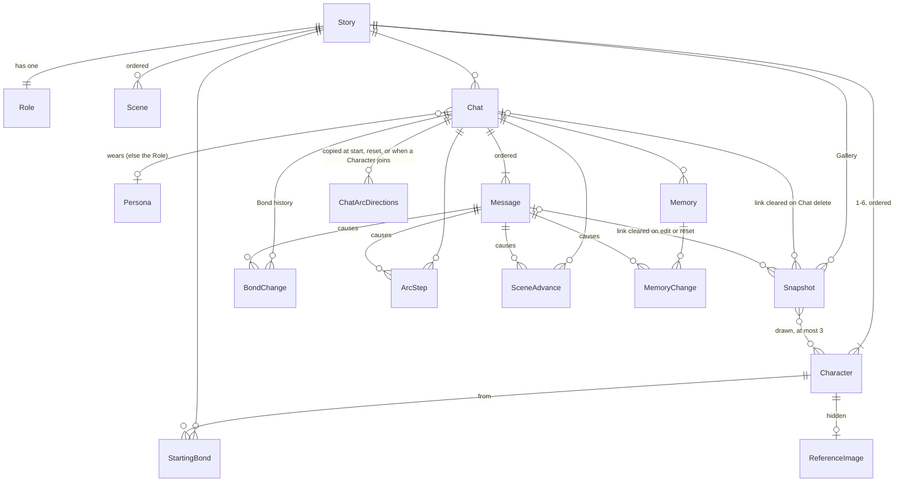

# Data model sketch

This is the logical model for [Data model](../issues/11-data-model.md): entities, fields, relations and lifecycle. Field names are illustrative.

Hosting ([ticket 10](../issues/10-hosting-and-access.md)) sets three things:
- The store is one PostgreSQL database, with a separate dev database.
- Images are files on disk. The database holds only their paths, relative to the image folder.
- There are no user, account or session entities.

## App level

- **Settings** (one per app):
  - play model (one app-wide setting, per ticket 05)
  - image model
  - a low-credit warning threshold for each credit pool, text and image (default ~20%)
- **Persona**: name and description. Personas belong to the app, not to a Story. A Persona has no appearance field, because Snapshots show the scene through the user's eyes and never draw the user.
- **UsageRecord**: one per model call. Fields:
  - time
  - kind: turn, Bond/Arc/Scene judge, Memory extraction, Story draft, field rewrite, Story assistant, Snapshot prompt, Snapshot image, or Reference image
  - credit pool: text or image
  - model and host
  - tokens or images
  - cost
  - the Chat or Story it served, if any

  Each pool's monthly spend is the sum of its records. Remaining credit is read from each provider.

## Authoring (a Story and what hangs off it)

- **Story**: title, Setting (text), Opening (text), and four Style fields:
  - POV: 1st, 2nd or 3rd
  - tense: past or present
  - reply length: short, medium or long
  - Image style: text

  A Story has no draft or published state. It is *playable* when every required field is filled. This is derived, never stored.
- **Role** (exactly one per Story): name and description.
- **Character** (1–6, ordered): name, appearance, personality, voice, example lines (an ordered list of strings), background, secrets (one text block), Arc directions (one text block).
- **ReferenceImage** (at most one per Character): an image path. It belongs to the Story, not a Chat, and is never shown during play. It is regenerated only when the author chooses, for example after Appearance or Image style changes. A new one replaces the old.
- **StartingBond**: from a Character, toward either the Role or another Character in the same Story, with a label and a description. There is at most one per direction.
- **Scene** (ordered): name, situation/goal, and a move-on condition. Only the last Scene may leave the condition empty.

Story edits reach existing Chats live, because Chats reference the Story, Role, Characters and Scenes. The exceptions are copied into a Chat at start or reset:
- the Opening becomes Message 1
- StartingBonds seed the Chat's first BondChanges
- Arc directions are copied into ChatArcDirections

## Playing (a Chat and what hangs off it)

- **Chat**: Story, title (default "Chat N", renameable), created at, last played at, worn identity (the Role or a Persona), and current Scene (a Scene, or none, which means free play).
- **Message** (ordered within its Chat):
  - **User Message**: text, and the identity the user wore at the time, kept both as a reference and as a stamped name. The stamped name keeps showing after the Persona is renamed or deleted.
  - **AI Message**: ordered parts, each either narration or one Character's speech. A speech part holds the Character reference and a stamped speaker name. The message also records which model wrote it ("author" for the Opening) and the status of its two background calls (pending, done or failed, with Retry).
  - An AI Message is stored only once it completes. If a turn fails, the User Message stays with a Retry.
- **Memory**:
  - text, with the user written as `{user}`
  - Known by: a set of Characters
  - written by: AI or user
  - locked
  - archived
  - causing Message, if any; a Memory the user wrote from scratch has none
- **MemoryChange**: one AI-made change to one Memory. Its kind is add, update, delete, merge, archive or a Known-by addition. It holds the value before and after, and the causing Message. A merge is recorded as the source Memories deleted plus the merged one added, all under one cause.
- **BondChange**: one Character's Bond toward the user or another Character, holding:
  - label and description
  - the story event
  - the causing Message, which is empty for the starting values seeded from the Story

  A Bond's current value is its latest change. The dashboard can expand a Bond to show its history.
- **ArcStep**: Character, step text, the story event and the causing Message. A reversal is a new step, never an edit.
- **SceneAdvance**: from Scene, to Scene (or free play), stamped Scene names, the story event and the causing Message. A turn advances at most one Scene.
- **ChatArcDirections**: a Character's Arc directions as copied into this Chat.
- **Snapshot** (in the Story's Gallery):
  - image path (2:3, fixed size)
  - the image prompt used
  - the user's optional hint
  - image model and cost
  - the Characters drawn: at most 3, each a reference plus a stamped name
  - an optional link to the Chat and to the AI Message it was taken at; one Message can have several Snapshots

  A Snapshot is stored only when its image succeeds; a failure shows an error with Retry. A Snapshot never causes a Memory, Bond, Arc or Scene change and is never sent to the text model.

Every AI-made change to Memory, Bond, Arc or Scene is a record tied to the Message whose turn caused it. User actions on Memory (write, edit, delete, restore from Archived) are not tied to a Message. A user edit or restore locks the Memory.

## Lifecycle

| Event | What happens |
|---|---|
| **Send** | The next turn's prompt waits until the previous turn's background changes are saved. |
| **Edit User Message N** | Messages after N are deleted permanently, with every change they caused. N is overwritten; no version history is kept. The AI writes a fresh reply. |
| **Edit AI Message N** | Messages after N are deleted, with their changes. N's own changes are rolled back. N is overwritten from `@Name:` text and split into parts again. Both background calls run again on the new text, then the Chat waits for the user. |
| **Edit (either kind)** | Snapshots of N and of the discarded Messages lose their Message link and leave the timeline. They stay in the Gallery. |
| **Rollback rule** | Changes are undone newest first. An AI-added Memory from a discarded Message goes, even if the user has since edited it. Memories the user wrote from scratch stay. The user sees a short count of what was rolled back. |
| **Reset Chat** | The title and worn identity are kept. All Messages, all Memory (including user-written), Bond history, Arc steps and Scene advances are cleared. Then the current Opening is copied in as Message 1, StartingBonds are seeded and Arc directions are copied. The Chat goes to the first Scene, or free play if the Story has no Scenes. Snapshots lose their Message link and stay in the Gallery. |
| **Swap Role ↔ Persona** | Changes only the Chat's worn identity, and an edit never rolls it back. Bonds and Memory carry over. |
| **Delete Persona** | Chats wearing it fall back to the Role. User Messages keep their stamped name. |
| **Add Character** | It joins every Chat as a stranger, with no Bonds or history. Its Arc directions are copied into each Chat. A user-written Memory is known only by the Characters present when it was written. |
| **Remove Character** | Takes effect after a warning, in every Chat. Deleted: its Bonds in both directions (including StartingBonds pointing at it) and their history, its Arc steps, its copied Arc directions and its ReferenceImage. It is dropped from every Known by. A Memory left with nobody in Known by stays, because the Narrator knows everything. Speech parts and Snapshots keep its stamped name; their link to the Character is cleared. |
| **Add Scenes** | A Chat with no current Scene enters the first new Scene placed after the last Scene it finished. If it never had a Scene, it enters the first Scene. |
| **Reorder Scenes** | Each Chat stays on the same Scene. |
| **Remove Scene** | A Chat on that Scene moves to the next Scene in order, or to free play if it was the last. SceneAdvances keep their stamped names. |
| **Required Story field emptied** | Its Chats stay readable, but sending is blocked until the field is filled again, with a note naming the missing field. |
| **Delete Chat** | Deleted permanently with everything under it, except its Snapshots. They stay in the Gallery with their Chat and Message links cleared. |
| **Delete Snapshot** | Removed from the Gallery and the timeline. Its image file is deleted. |
| **Delete Story** | After confirmation, deletes the Story with its Role, Characters, Scenes, StartingBonds, every Chat, its Gallery, its ReferenceImages and their image files. |
| **Story assistant Undo** | Exists only while the page is open. Nothing is persisted, and Stories have no version history. |
